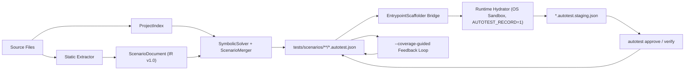

# Language Integration Guide

This guide explains how to add support for a new programming language, static extractor, runtime hydrator, test runner bridge, and coverage-guided feedback collector to **Autotest**.

---

## Architecture & Data Flow

Autotest separates **language-agnostic symbolic contract solving** (in `crates/autotest-core`) from **language-specific extraction and execution** (`crates/autotest-*-extractor`, `adapters/extractors/*`, and `adapters/hydrators/*`).



### Component Responsibilities

| Component | Location | Language-Specific? | Responsibility |
| --- | --- | --- | --- |
| **IR & Schema** | `crates/autotest-core/src/ir.rs`, `schema/scenario.v1.schema.json` | No | Declarative JSON contract format (`ScenarioDocument`, `TargetDefinition`, `ScenarioDefinition`) |
| **Cross-File Index** | `crates/autotest-core/src/project_index.rs` | Partial | Indexes classes, interfaces, method return types, mutators, and string constants |
| **Symbolic Solver** | `crates/autotest-core/src/solver.rs` | No | Generates boundary, branch, static factory, higher-order, mock, metadata, and producer-chain scenarios |
| **Merger & Cache** | `crates/autotest-core/src/merger.rs`, `cache.rs` | No | Preserves `locked: true` assertions, flags `stale: true` drift, computes Tarjan SCCs |
| **Static Extractor** | `crates/autotest-<lang>-extractor/` or `adapters/extractors/<lang>-extractor/` | **Yes** | Parses source AST/types into `ScenarioDocument` targets, constraints, and side effects |
| **Runtime Hydrator** | `adapters/hydrators/<runner>-autotest/` | **Yes** | Hydrates DTOs/mocks/callbacks, invokes target, records `.staging.json`, asserts outcomes |
| **Bridge Scaffolder** | `crates/autotest-core/src/scaffolder.rs` | **Yes** | Emits native test runner entrypoint (`test.each`, `#[DataProvider]`, etc.) |
| **CLI & Coverage Loop** | `crates/autotest-cli/src/config.rs`, `lib.rs`, `coverage_feedback.rs` | **Yes** (wiring) | Project auto-detection, extractor dispatch, sandboxed recording, coverage parsing |

---

## Step 1: Static Extractor & Cross-File Indexing

You can implement an extractor either as a **built-in Rust crate** (fast, zero external runtime dependencies for extraction) or as an **external JSON-RPC 2.0 worker** (ideal when you want to leverage the target language's official compiler API).

### Option A: Built-in Rust Extractor Crate

Model your crate on `crates/autotest-php-extractor/src/lib.rs` or `crates/autotest-ts-precheck/src/lib.rs`:

1. Create `crates/autotest-<lang>-extractor` and add it to the root `Cargo.toml` `[workspace].members`.
2. Expose:
   ```rust
   pub fn extract_source(file_path: &str, content: &str) -> Result<ScenarioDocument, ExtractorError>
   ```
3. Populate **`SourceMetadata`**:
   - `file`: relative file path (`file_path`).
   - `content_hash`: `"sha256:<hex>"` of the full source file.
   - `analyzer`: e.g. `"my-lang-parser@1.0.0"`.
   - `dependencies`: `BTreeMap<String, String>` mapping non-primitive constructor/injected type names to `"contract_sha256:discovered"`.
4. Populate **`TargetDefinition`** for each testable public method or exported function:
   - `id`:
     - Instance/static methods: `"ClassName::methodName"` (PHP/Rust/C++-style) or `"ClassName.methodName"` (TS/JS/Python/Go-style). `SymbolicSolver::split_class_method` splits on `::` or `.`.
     - Standalone functions: `"functionName"`.
   - `kind`: `TargetKind::Method` or `TargetKind::Function` (`TargetKind::HttpEndpoint` for route endpoints).
   - `signature` (`SignatureDefinition`):
     - `constructor_args`: `Vec<ParameterDefinition>` for class constructor/DI parameters.
     - `parameters`: `Vec<ParameterDefinition>` for method/function parameters.
     - `return_type`: `Option<String>`.
     - `static_factories`: `Vec<FactorySignature>` for named constructors / static factories returning `self`/`static`/`ClassName`.
     - `implements`: `Vec<String>` of implemented interfaces / traits / protocols or base classes.
     - `private_constructor`: `bool` (`true` if constructor is private/protected so the solver uses `static_factories`).
   - `detected_side_effects`: `Vec<DetectedSideEffect>`:
     - **Mockable** (`mockable: true`): `"interface_call"`, `"service_call"` (format `target` as `"<depParamName>.<methodName>"`), `"clock_read"`, `"rng"`.
     - **Unmockable** (`mockable: false`): `"unmockable_side_effect"` (e.g. `process.exit`, `eval`, destructive sync FS writes, raw socket `.listen()`). Targets with any `mockable: false` side effect are automatically skipped by `SymbolicSolver`.
   - `metadata_keys`: `Vec<String>` of reflection/decorator metadata keys read in the body (e.g. `PATH_METADATA`, `'roles'`).

#### Parameter Constraints Understood by `SymbolicSolver`

| Constraint | Meaning | Solver Effect |
| --- | --- | --- |
| `finite` | Numeric parameter | Enables numeric boundary handling |
| `>= 0.0` / `> 0` | Non-negative / positive guard | Synthesizes `0`/`0.0` boundary + negative guard `*_throws` scenario |
| `non-empty-string` | Rejects empty string | Synthesizes `""` negative guard `*_throws` scenario |
| `length == N` | Fixed string length | Synthesizes valid N-char nominal + `(N-1)`-char negative guard |
| `variadic` | Rest/variadic parameter (`...args`) | Unpacks synthesized array items in builder/producer calls |
| `eq:<lit>` | String equality / `match` / `switch` arm | Synthesizes `*_branch_<param>_<lit>` scenario |
| `branch_num:<n>` | Numeric guard branch (`< 0`, `<= 0`) | Synthesizes `*_branch_<param>_<n>` scenario |
| `prop:<field>` | Object property / dict key access | Populates `{ "<field>": ... }` in `*_with_props` scenario |
| `prop_bool:<field>:true\|false` | Explicit boolean property check | Sets boolean hint on `<field>` |
| `prop_arr:<field>` | Array-check on property | Sets array value on `<field>` |

### Option B: External JSON-RPC 2.0 Worker

Model your worker on `adapters/extractors/ts-extractor/src/Worker.js` and `adapters/extractors/phpstan-extractor/src/Worker.php`, using the protocol defined in `crates/autotest-proto/src/lib.rs`:

- **Request** (`ping` and `extract_file`):
  ```json
  {
    "jsonrpc": "2.0",
    "id": 1,
    "method": "extract_file",
    "params": {
      "file_path": "src/OrderService.py",
      "source_content": "...",
      "options": {}
    }
  }
  ```
- **Success Response** (`ExtractorResponsePayload`):
  ```json
  {
    "jsonrpc": "2.0",
    "id": 1,
    "result": {
      "file": "src/OrderService.py",
      "impl_hash": "sha256:...",
      "public_contract_hash": "contract_sha256:...",
      "dependencies": { "PaymentGateway": "contract_sha256:discovered" },
      "targets": [ ... ],
      "diagnostics": []
    }
  }
  ```
- **Error Codes**: `-32700` (parse error), `-32600` (invalid request), `-32601` (method not found), `-32602` (invalid params), `-32603` (internal error).

### Cross-File `ProjectIndex` Integration

In `crates/autotest-core/src/project_index.rs`, extend `ProjectIndex::index_source_metadata` for your language so Pass 1 of `autotest generate` captures:

1. **Interface / Protocol Method Return Types** (`interface_methods`): enables type-aware mock returns and multi-factory return variants (e.g. returning `MatchingResult::fromSuccess` and `MatchingResult::fromFailure` for an interface method returning `MatchingResult`).
2. **Exported String Constants** (`string_constants`): resolves symbolic metadata keys (e.g. `PATH_METADATA` → `"path"`) for metadata seeding.

`ProjectIndex::index_document` automatically indexes classes, `implements` mappings, `static_factories`, `mutators`, and `method_return_types` from every extracted `ScenarioDocument`.

---

## Step 2: Runtime Hydrator Adapter

Create `adapters/hydrators/<runner>-autotest/` with the standard 7-module architecture (modeled on `adapters/hydrators/jest-autotest/src/` and `adapters/hydrators/phpunit-autotest/src/`):

1. **`Loader`**:
   - Reads `*.autotest.json` and recursively resolves `{"$ref": "#/fixtures/<key>"}` references against `doc.fixtures`.
2. **`DtoHydrator`** (4-tier hydration):
   - **Tier 1 (Custom Factories)**: Look up project-specific overrides (e.g. `tests/autotest.factories.<ext>`).
   - **Built-in `$type` Codecs**:
     - `Callback`: `{ "$type": "Callback", "returns": <spec> }` → native closure/lambda returning `hydrate(returns)`.
     - `AutoMock`: `{ "$type": "AutoMock", "class": "<Type>", "methods": { ... } }` → delegate to `MockBinder`.
     - `DecoratedClass`: `{ "$type": "DecoratedClass", "kind": "class|instance|prototype|method", "metadata": {...}, "method_name": "handle", "method_metadata": {...} }` → dynamic class/type with attached runtime metadata.
     - `Date` / `DateTimeImmutable`, `Map`, `Set`, `Buffer` / `Uint8Array`, `Undefined`, `Number`, `ClosureMarker`.
   - **Tier 2 (Static Factory)**: If `$factory` is present, invoke `TargetClass.<$factory>(...hydratedCtorArgs)`.
   - **Tier 3/4 (Constructor / Reflection Fallback)**: Instantiate via `$ctor` (or uninitialized object fallback), assign `$props`, and replay `$setup_calls` (reassigning the instance if a fluent/immutable setup call returns an instance of the same class).
   - If `$source_file` is present on a cross-file DTO, ensure its module/file is loaded before instantiation.
3. **`MockBinder`**:
   - Enforce `when_args` matchers: `any`, `exact`, `regex`, `range`, `subset`, `gt`, `gte`, `lt`, `type`.
   - Apply `mutate_args` mutations on passed-in arguments.
   - Replay sequential `returns` (`return`/`value`, `exception`, `reject`).
   - Verify `expect_calls` counts after invocation.
   - **Type-Aware Recursive Auto-Mocking**: For unconfigured methods on mocked interfaces/dependencies, return `$this`/`this` for fluent `self`/`static` methods, synthesized defaults for typed return values, and safe non-hanging traps (never return a callable `then` on a dynamic proxy unless it is genuinely a `Promise`).
4. **`TargetInvoker`**:
   - If `scenarioSpec.factory` is set, instantiate the target class via that static factory method instead of the constructor.
   - Apply `scenarioSpec.constructor_overrides` (hydrated populated producers) before falling back to `MockBinder` auto-mocks.
   - Replay `scenarioSpec.setup_calls` (reassigning `instance` for immutable fluent builders).
   - Unpack variadic arguments when the target parameter is variadic and does not accept a raw list.
   - Apply `scenarioSpec.metadata_seeds` before invocation and clean up in `finally`.
   - If `scenarioSpec.invoke_returned_args` is an array and the return value is callable, invoke it (with `new` fallback if it is a class constructor/mixin).
   - Guard `async` calls with a short timeout (e.g. `250ms`–`1000ms`) so unresolving stub callbacks fail fast rather than hanging the test runner.
5. **`RecorderHook`**:
   - When `AUTOTEST_RECORD` is set (or `options.record` is true), write recorded outcomes to `<file>.autotest.staging.json`:
     ```json
     [
       {
         "target": "Class::method",
         "scenario": "scenario_name",
         "recorded_at": "2026-11-22T20:00:00Z",
         "mode": "recorded",
         "expected": {
           "outcome": "return",
           "type": "string",
           "value": "result"
         }
       }
     ]
     ```
   - For non-deterministic targets (`rng`, `clock_read`), functions/closures, and opaque runtime/mock objects, record `{ "outcome": "return", "type": "<InterfaceOrClassOrObject>" }` **without** a volatile `value` so record → replay never flakes.
6. **`OutcomeAsserter`**:
   - `outcome: "return"`: assert exact hydrated `value` (or `type` / `instanceof` check when `value` is omitted).
   - `outcome: "exception"`: assert `exception_type` and `message_contains`.
   - `outcome: "no_crash"`: assert no exception was thrown.
7. **`AutotestHydrator` Entrypoint**:
   - Coordinates `Loader`, `DtoHydrator`, `MockBinder`, `TargetInvoker`, `RecorderHook`, and `OutcomeAsserter`.

---

## Step 3: Native Test Runner Bridge

In `crates/autotest-core/src/scaffolder.rs`, add:

```rust
pub fn generate_<runner>_bridge(scenario_dir: &str) -> String
```

Every bridge file MUST:
1. Walk `scenario_dir` recursively for `*.autotest.json` (ignoring `*.autotest.staging.json`), sorted deterministically.
2. Support targeted single-file and single-scenario execution via environment variables:
   - `AUTOTEST_FILE`: filter to a single scenario file path.
   - `AUTOTEST_INDEX`: 0-based global scenario index.
3. Label each test case as `[#<index>] <target.id> :: <scenario.name>`.
4. Delegate execution to the language's `executeAutotestScenario` / `AutotestHydrator::executeScenario`.

---

## Step 4: CLI, Config, Sandbox & Coverage-Guided Wiring

Wire the new language into `crates/autotest-cli`:

1. **`crates/autotest-cli/src/config.rs`**:
   - Add a default `LanguageConfig` entry in `AutotestConfig::default()` (`source_roots`, `extractor`, `fallback_extractor`, `test_framework`, `bridge_file`, `include_paths`, `exclude_paths`).
2. **`crates/autotest-cli/src/lib.rs`**:
   - **`handle_init` / `should_run_language` / `detect_source_roots`**: detect project manifest files (e.g. `pyproject.toml`, `go.mod`, `Cargo.toml`) and configure `autotest.toml` only for ecosystems present in the repository.
   - **`handle_sync_tests`**: scaffold the new runner bridge via `EntrypointScaffolder`.
   - **`handle_generate_with_options`**: match source file extensions, classify empty/interface-only files in `classify_empty_source`, dispatch to your extractor, and ensure `ProjectIndex::index_source_metadata` runs in Pass 1.
   - **`has_scenarios_for_language`**: match the new source file extension in `doc.source.file`.
   - **`handle_record_execution`**: invoke the native test runner (or an embedded standalone runner via `include_str!`) through `SandboxRunner::run_command_with_env` with `AUTOTEST_RECORD=1`.
3. **`crates/autotest-cli/src/coverage_feedback.rs`**:
   - Add a branch in `collect_uncovered_lines` that runs your language's coverage tool (prefer LCOV, Clover XML, or Istanbul JSON so you can reuse `parse_lcov_uncovered`, `parse_clover_uncovered`, or `parse_istanbul_uncovered`) and returns `BTreeMap<String, Vec<usize>>` mapping relative source files to sorted 1-based uncovered line numbers.

---

## Step 5: Conformance Suite, Tests & Common Pitfalls

### Verification Checklist

1. **Core & Extractor Tests**:
   - Add unit tests in `crates/autotest-<lang>-extractor` covering classes, standalone functions, constructors, static factories, variadics, constraints, and side-effect filtering.
   - Verify `cargo test` passes all conformance tests (`conformance/core/01..25`).
   - Add language profile scenarios under `conformance/profiles/<lang>/`.
2. **Hydrator Runtime Tests**:
   - Add a standalone runtime test script in `adapters/hydrators/<runner>-autotest/` testing `Loader`, `DtoHydrator` (all 4 tiers + codecs), `MockBinder` (matchers + recursive mocks), `TargetInvoker` (`factory`, `setup_calls`, `invoke_returned_args`), `RecorderHook`, and `OutcomeAsserter`.
3. **CLI Pipeline Integration Tests**:
   - Add an end-to-end test in `crates/autotest-cli/tests/pipeline_test.rs` exercising `handle_init` → `handle_generate` → `handle_record_execution` → `handle_approve` → `handle_verify`.
4. **Real-World Repo Verification**:
   ```bash
   autotest init
   autotest sync-tests
   autotest generate --force-all --record --coverage-guided
   autotest approve
   autotest verify
   ```
   Then run the native test runner with coverage and confirm **0 failures / 0 errors**.

### Common Pitfalls

- **Record vs. Replay Mock Parity**: If standalone record mode (`run.php` / `node --test`) uses a different mock implementation than replay mode (`PHPUnit::createMock` / `Vitest`), ensure both return identical defaults for unconfigured typed methods (`self`/`static`, final classes) and record mock returns as type-only.
- **Async `Proxy` `then` Trap**: In dynamic languages with `thenable` duck-typing (JS/TS), a recursive mock `Proxy` must explicitly return `undefined` for `then`, `catch`, and `finally`, otherwise `await mock` hangs indefinitely.
- **Uninitialized Readonly / Final Objects**: Never pass `newInstanceWithoutConstructor()` (or raw `Object.create`) into typed methods when static factories or constructors are available; prefer `static_factories` or constructor invocation.
- **Non-Deterministic Outputs**: Always tag RNG, UUID, and clock calls as `rng`/`clock_read` side effects (or detect random/opaque runtime types in `RecorderHook`) so `expected` asserts `type` rather than a changing literal value.
- **Variadic Parameters**: Strip `...` in the extractor, tag the parameter with `"variadic"`, and unpack list arguments in `TargetInvoker` / `DtoHydrator` only when the parameter type does not accept a raw array.
